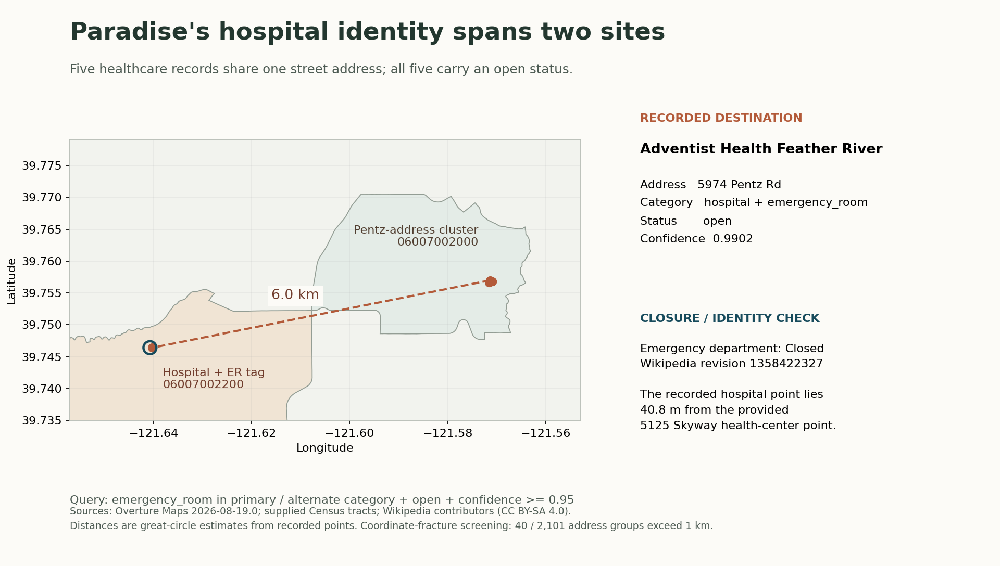

# An open emergency-room tag at a closed hospital identity in Paradise

**Best Bias Discovery / Best Documentation — submitted methodology**  
Prepared by **blucca**, with an autonomous AI research assistant. Analysis date: **15 October 2026**. Zindi username: **blucca**. Associated submission: **NQUquvhM**, accepted and scored **0.449105407 RMSE** on 15 October 2026. Public reproduction: **https://github.com/blucca/paradise-map-audit**.

## Best Bias Discovery: the finding

In the supplied **Overture 2026-08-19.0** extract, a high-confidence emergency-room search in five Paradise-area census tracts returns **one place**: Adventist Health Feather River. Its record combines:

- `hospital`, with `emergency_room` as an alternate category;
- `operating_status = open` and existence confidence **0.9902193**;
- the address **5974 Pentz Road**;
- coordinates **40.8 metres** from the supplied **5125 Skyway health-center** record.

The openly licensed hospital-history source identifies its emergency department as **Closed**. Five healthcare records sharing the Pentz address span **6.035 km** and **two census tracts**; all five carry `open`. The two identically named Adventist records are **6.005 km** apart.

This is a specific post-disaster **identity, location, and service-capability conflict**. An emergency-resource query retains the obsolete capability even after applying a high existence-confidence threshold. The conflict lives at the place-record and service level, below the scorecard's tract-level coverage averages.

AI assistance covered research, code drafting and review; reproduction runs in open-source Python/SQL. Code: **MIT**. Report and derived tables: **CC BY-SA 4.0**. Source-specific attribution and licensing accompany the records in `evidence/`.



## Evidence and provenance

### 1. The supplied map records

All five rows below have the first address `5974 Pentz Rd`, locality `Paradise`, ZIP `95969` or `95969-5509`, and operating status `open`.

| Place | Category | Root provider | Confidence | Coordinate's tract |
|---|---|---|---:|---|
| Adventist Health Feather River | hospital; alternate emergency_room | Meta | 0.9902 | 06007002200 |
| Adventist Health Feather River | home_health_care | Microsoft | 0.9199 | 06007002000 |
| The Birth Day Place | hospital | Meta | 0.9199 | 06007002000 |
| Feather River Hospital Clinical Laboratories | hospital | BrightQuery | 0.3500 | 06007002000 |
| Paradise Anesthesia Associates | health_and_medical | BrightQuery | 0.8500 | 06007002000 |

The primary finding concerns hospital record **`1cdcf1b2-9a30-4c77-b5ff-bee7d99f652e`**. Its Meta source timestamp is **2026-08-10**; its separate `Overture-signals` operating-status timestamp is **2026-07-20**. These fields record source-update dates. The emitted evidence preserves every source property, provider, record ID, date, and confidence.

The comparison health-center record is **`d5a3c5d0-5a2d-481f-9e4b-c7342ebd14c3`**, named Feather River Health Center and addressed **5125 Skyway Rd, Lower Level**. Both comparison points come from the permitted challenge extract. The five Pentz rows describe several healthcare identities and services; their address disagreement is the audit unit.

### 2. Openly licensed closure and identity evidence

The archived [Wikipedia revision 1358422327](https://en.wikipedia.org/w/index.php?title=Adventist_Health_Feather_River&oldid=1358422327), last edited **2026-06-08**, states **“Emergency department — Closed”** and describes the hospital's closure after the November 2018 Camp Fire. Attribution: **Wikipedia contributors**, **CC BY-SA 4.0**. The repository includes the retrieved HTML, revision, source URL, license, and the extracted statement in `evidence/closure.json`.

[Wikidata Q5439589, revision 2541624292](https://www.wikidata.org/w/index.php?title=Q5439589&oldid=2541624292), **CC0**, supplies a hospital identity/coordinate cross-reference at **39.7569, -121.571**, near the Pentz cluster. Its snapshot is also included. The Wikipedia infobox's mixed current address and historic coordinates are preserved in the archived source; the spatial comparison uses the supplied map points and the explicitly identified Wikidata coordinates.

### 3. Corroborating operator context

The operator's [current History](https://www.adventisthealth.org/feather-river/about-us/history/) describes the shelved hospital-rebuilding project and continuing outpatient services. Its [Rapid Care page](https://www.adventisthealth.org/feather-river/services/rapid-care/) identifies **5125 Skyway** and care for non-life-threatening issues. Its [2019 Community Health Needs Assessment, p.9](https://www.adventisthealth.org/documents/feather-river/featherriver-2019-communityhealthneedsassessment.pdf) records the hospital's closure and historical Pentz address. Retrieved **2026-10-15**. These links provide separately attributed context; the executable evidence chain uses the supplied data and the archived Wikimedia sources.

### 4. Current-release follow-up

In **2026-09-23.1**, a direct GERS/DuckDB check on **15 October 2026** found the same UUID still labelled `hospital`/`open`, with the Pentz address and Skyway location. Current `taxonomy.alternates` is **null**; the emergency-room finding applies to **August**. [Overture issue #583](https://github.com/OvertureMaps/data/issues/583) requests facility-level correction. [Archived September fields and registry row](https://github.com/blucca/paradise-map-audit/blob/main/evidence/current-release.json) preserve this check. The challenge calculations retain their original inputs.

## A measurable consequence for emergency-resource selection

The query operates on tracts **06007001800, 06007001900, 06007002000, 06007002100, and 06007002200**. Their supplied **2020 Census population totals 5,126**. Their SVI scores are from **2022**. These named tracts define the study window.

```sql
WHERE GEOID IN ('06007001800','06007001900','06007002000',
                '06007002100','06007002200')
  AND (category = 'emergency_room'
       OR list_contains(alternate, 'emergency_room'))
  AND operating_status = 'open'
  AND confidence >= 0.95
```

| Reproducible step | Result |
|---|---:|
| Matching emergency-resource candidates | 1 |
| Candidates matched to the licensed closed-ED evidence | 1 |
| Candidate IDs moved to a capability-conflict review queue | 1 |
| Remaining candidates in this query's automatic-use set | 0 |

The flag is scoped to **emergency-department capability**. A correction workflow can retain the operating clinic identity, align its address and coordinates, and review its emergency category separately. This matters for a resident-facing service locator or an evacuation-planning inventory that selects destinations from category, operating status, and confidence. The experiment measures the returned destination and review disposition. Travel times, patient journeys, and dispatch outcomes require operational measurements.

Overture's [confidence documentation](https://docs.overturemaps.org/guides/places/) defines confidence as place-existence evidence. Here, the emergency-category conflict survives an existence-confidence threshold of 0.95. The useful additional check is capability-aware reconciliation of the place identity and its dated closure record.

## Regional screening and the original hypothesis

The audit joins **116,897 places** to **591 supplied tract polygons**. All places intersect the study-region tracts. **Four boundary points** intersect multiple tracts and are listed separately; **116,893** have a unique tract assignment. The named case has unique point assignments.

Using the `health_care` taxonomy hierarchy and the first provided street/city/ZIP address yields **13,323 addressed healthcare records**. Case-folded alphanumeric street and city strings, plus five-digit ZIP, define exact-address groups; unit text remains part of the key. Among **2,101 groups with at least two records**, **40 (1.90%)** span more than **1 km**. These are **coordinate-fracture screening candidates**, with the Paradise case supplying the source-checked emergency-capability example.

The exploratory comparison grouped addresses by their modal coordinate tract, resolving ties by sorted GEOID. In the **Rural / SVI [0.25, 0.5)** cohort, **4 of 28 groups** exceed 1 km; median span is **31.4 m**. The outputs expose modal ties and each group's full urban/rural and SVI range. The three large-span comparison groups each span multiple tracts, so the grouping convention participates in their stratum assignment. This table supplies screening context.

The initial hypothesis sought broader enrichment in recently burned areas. Under the exploratory grouping rule, the recent/cumulative-heavy-burn group contained **1 of 9** large-span groups, versus **3 of 19** in its comparison group; two-sided Fisher **p = 1.0**. **That hypothesis failed its enrichment gate.** The final claim is the verified Paradise identity/capability conflict. The MTBS filter uses last fire year >=2018 and cumulative burned-area percentage >=50; cumulative percentages can exceed 100.

## Reproduction and associated leaderboard entry

```sh
python -m pip install -r requirements.txt
python reproduce.py --work-dir ./temp/reproduction
```

The repository includes the exact supplied inputs used in the analysis, source URLs and retrieval dates, the licensed closure snapshots, and locked dependency versions. The script produces:

- point/tract join and boundary audit;
- all regional address groups and explicit screening labels;
- the five full case records, comparison point, tract attributes, and distances;
- the exact emergency query, result, and evidence-based review disposition;
- the figure and the **9,794-row midpoint CSV** used in submission **NQUquvhM**.

The CSV assigns **0.5** to `coverage_gap_score` for each distinct GEOID in the official platform **SampleSubmission.csv**, archived in `data/platform-SampleSubmission.csv`. The live platform sample contains **9,794 IDs**: the four advertised regions' **9,379**, plus **415 Eastern Washington** tracts. The live validator rejected the four-region list for missing Washington IDs; entry **NQUquvhM** includes the complete platform list and passed processing. The extra IDs receive the same neutral value; the Paradise discovery still uses the pinned Northern California data.

This deterministic midpoint minimizes worst-case squared error for a bounded [0,1] target. Its role is to associate the discovery with a transparent, reproducible leaderboard entry. Model-training examples and learned parameters both have count **0**. The method reads only the provided GEOID list and applies **0.5 uniformly**, including zero-population, water-dominated and data-sparse tracts. It does not estimate individual road, building or POI components; those optional columns are omitted, and component weightings are unused. The official acceptance receipt and public RMSE establish the submitted file's processing result. The discovery prize's record-level evidence is evaluated separately from this neutral scoring baseline.
